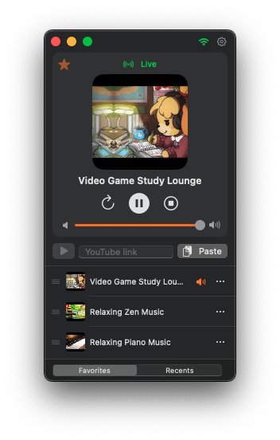

# Airwave

**A lightweight, native macOS audio stream and YouTube audio player built with SwiftUI.**


Airwave lets you listen to live internet radio, direct audio streams, and YouTube videos or live broadcasts without keeping a heavy web browser tab open. Designed for macOS 13 (Ventura) and later, it integrates seamlessly with system media controls, the Control Center Now Playing widget, and keyboard shortcuts.



---

## Features

- **Hybrid Stream Playback:** Play direct audio stream URLs (`mp3`, `aac`, `m4a`, `m3u8`, etc.), HLS streams without a file extension, and audio-only or live streams from YouTube links automatically. Links without a recognised extension are accepted when the server answers with an audio or HLS stream.
- **Favorites:** Save stations and streams under a unique name (case-insensitive). The same link can be saved several times with different names and trims. Remove them from the row's `…` menu, reorder them by dragging, and rename them in **Settings → Favorites**. Import and export your list as a JSON file from Preferences; identifiers are never exported, and a file with conflicting names asks how to resolve them (create duplicates, overwrite, or ignore).
- **Custom Thumbnails:** In **Settings → Favorites**, give a favorite your own artwork by importing a clipboard image or an image file. The cover is applied everywhere the track appears and is never replaced by automatic fetching. The trash button clears it and fetches the automatic artwork again.
- **Show in Settings:** A favorite's `…` menu opens **Settings → Favorites** with that favorite selected.
- **Recent History:** A Recents view, switched with Favorites from the bar at the bottom of the main window, remembers recently played tracks for quick replay, numbered in order (the same numbering appears in the Dock menu's **Recent Tracks** submenu). The history size (1–20, default 5) and a "Clear history" action live in **Settings → Recents**.
- **Volume Control:** In-app volume slider from 0% to 100% (default 75%), with snap stops every 25%. ⌘↑ and ⌘↓ change the volume by 10%.
- **ICY "Now Playing" Metadata:** For direct radio streams (Icecast/Shoutcast), Airwave reads inline ICY metadata to show the station name and the current song — in the player card and in macOS Control Center.
- **Artwork:** Thumbnails come from YouTube metadata, OpenGraph (`og:image`), Twitter cards (`twitter:image`), or domain favicons. They are downscaled to 360 px and stored once per image in the caches folder, so tracks that share an image store it once. Artwork is refreshed on every play, and **Refresh Thumbnails** in **Settings → Favorites** re-fetches every favorite's artwork. Recents are refreshed when they are played.
- **Thumbnail Display:** In **Settings → General → Appearance**, choose **Fill** (crop to a square) or **Fit** (the whole image over a blurred copy of itself). The choice applies everywhere artwork appears.
- **Native macOS Integration:**
  - Full support for `MPNowPlayingInfoCenter` (Control Center & Lock Screen artwork and playback state) and `MPRemoteCommandCenter` (hardware media keys).
  - Live network status indicator (`Connected`, `Weak connection`, `No network`) with an immediate, color-coded hover label, plus a quick Preferences button embedded directly in the window titlebar.
  - A right-click Dock menu with **Play/Pause** and a **Recent Tracks** submenu for quick playback.
  - Optional **Launch at Login** via `SMAppService`.
- **Playback Popover:** The arrow in the top-right of the player card opens a panel with the playing link (copyable, on one line) above the seek controls. The seek controls are greyed out for live streams that have no seekable timeline.
- **Seek Controls:** For finite tracks, rewind or fast-forward 10 seconds (regular buttons) or 30 seconds (small buttons). **Settings → General → Appearance** adds a second row of ±1.5 min and ±5 min buttons. Disabled for live streams, which have no seekable timeline.
- **Track Trimming:** In **Settings → Favorites**, set optional **Start offset** (from the start) and **End offset** (counted back from the end) in minutes and seconds for a favorite to trim its track on playback — applied from any entry point (Favorites, Recents, Dock, hotstart). Live streams ignore trim.
- **Links Typed By Hand:** A link typed in the field plays as a favorite when it matches exactly one favorite without a trim, or the first untrimmed favorite when several share it. Otherwise it plays as a new track. **Settings → Playback** can turn this off so every typed link plays as a new track.
- **Slow Loads:** A load that has not started playing within the chosen time (2–10 seconds, default 4) is restarted automatically, up to two times. **Settings → Playback** can turn this off.
- **Failed Favorites:** If a favorite fails to load, a dialog offers **Retry**, **Edit Link** (opens its settings), **Delete**, or **Cancel**. The previous track keeps playing.
- **End-of-Track Behavior:** Choose in **Settings → Playback** whether a finished track replays from the start (default) or stops. Applies to finite tracks only; live streams never end.
- **Hotstart:** Optionally resume your last played stream automatically as soon as the app launches (**Settings → Playback**). Only a stream that was playing when Airwave closed is resumed — a stopped stream is not restarted.
- **Background Playback Mode:** Choose in **Settings → General → App** whether closing the main window quits the application or keeps Airwave running silently in the background.

---

## Supported Streams & Limitations

Airwave is intentionally lightweight and relies on native `AVFoundation` playback combined with local YouTube stream extraction (`YouTubeKit`). Because it does **not** embed a headless web browser or bundle `yt-dlp`, please keep the following limitations in mind:

### What Works
- **Direct Audio & Playlist Streams:** Any `http://` or `https://` URL ending in `.mp3`, `.aac`, `.m4a`, `.m3u8`, `.ogg`, `.opus`, `.wav`, or `.flac`.
- **YouTube Videos & Live Streams:** Standard links (`youtube.com/watch?v=...`), short links (`youtu.be/...`), shorts (`youtube.com/shorts/...`), live links (`youtube.com/live/...`), and mobile links (`m.youtube.com`, `music.youtube.com`).

### Limitations (What Does Not Work)
- **Not a Universal Website Extractor:** Airwave cannot extract audio from arbitrary websites, radio station web portals, SoundCloud, Twitch, Mixcloud, or Spotify web pages. If you want to listen to an internet radio station (other than YouTube), you must provide its **direct stream URL** (e.g., an Icecast/Shoutcast `.mp3`/`.aac` mountpoint or `.m3u8` HLS manifest), not the URL of the station's homepage.
- **DRM, Age-Restricted, or Private YouTube Content:** Videos requiring authentication, cookies, age verification, or Widevine DRM cannot be resolved by `YouTubeKit`.
- **PLS Playlists:** `.pls` playlist files are **not** supported — `AVPlayer` cannot resolve them. Use the direct stream URL inside the playlist (e.g. the `.mp3`/`.aac` mountpoint) instead.
- **YouTube API Changes:** Because YouTube frequently updates its internal player formats, stream extraction may occasionally require updating the `YouTubeKit` dependency.

---

## Installation & Bypassing macOS Gatekeeper (Pre-built Releases)

Pre-compiled versions of `Airwave.app` are signed using an **ad-hoc local signature** (`codesign --sign -`) rather than a paid Apple Developer ID certificate. As a result, macOS Gatekeeper will quarantine the app after downloading it from a browser and show an *"Airwave.app cannot be opened because the developer cannot be verified"* or *"is damaged"* warning.

### How to Open a Pre-built Release

1. Download and extract `Airwave.app`, then move it to your `/Applications` folder.
2. **Method 1 — Terminal (Recommended & Fastest):**
   Open **Terminal** and remove the macOS quarantine extended attribute by running:
   ```bash
   xattr -cr /Applications/Airwave.app
   ```
   *(If you still need to refresh the local ad-hoc signature on your machine, you can also run `codesign --force --deep --sign - /Applications/Airwave.app`.)*
3. **Method 2 — Finder & System Settings:**
   - Control-click (or right-click) `Airwave.app` in Finder and choose **Open**.
   - On newer macOS versions, if blocked, open **System Settings → Privacy & Security**, scroll down to the **Security** section, and click **Open Anyway** next to the Airwave message.

---

## Building from Source

### Requirements
- **macOS 13.0 (Ventura)** or later
- **Xcode 15.0+** or **Swift 5.9+** Command Line Tools

### Repository Layout Note
Make sure the Swift source files are placed inside `Sources/Airwave/` as expected by `Package.swift`:

```text
Airwave/
├── Package.swift
├── VERSION                 # single source of truth for the app version
├── smoke-test.sh
├── .swift-format
├── Plugins/
│   └── BundleApp/          # `swift package bundle` command plugin
├── LICENSE
├── Resources/
│   ├── AppIcon.icns
│   └── screenshot.png
├── Tests/
│   └── Smoke/
└── Sources/
    └── Airwave/
        ├── AirwaveApp.swift
        ├── Components/
        ├── Services/
        ├── Utilities/
        └── Views/
```

### Build & Package `Airwave.app`

Airwave is a plain Swift package — no Xcode project. Packaging is a native SwiftPM command plugin, `bundle`, defined in `Plugins/BundleApp`. It reads the version from the root `VERSION` file, builds the `.app` bundle at `dist/Airwave.app`, writes the `Info.plist` (including `NSAllowsArbitraryLoads` so non-HTTPS radio streams can play), copies `Resources/AppIcon.icns` if present, and applies an ad-hoc code signature.

The plugin packages the binary, so build first, then bundle:

```bash
# 1. Clone the repository
git clone https://github.com/Sisyffe/Airwave.git
cd Airwave

# 2. Build the release binary
swift build -c release

# 3. Package the app (the plugin writes to dist/, so it needs permission)
swift package --allow-writing-to-package-directory bundle

# 4. Launch the built application
open dist/Airwave.app
```

The app version is single-sourced from `VERSION`: the plugin writes it into `Info.plist`, and the app reads it back at runtime from `CFBundleShortVersionString`. Bump `VERSION` to change the version everywhere.

### Testing

There is no XCTest/Swift Testing target because those require a full Xcode install; the project is built with the Command Line Tools only. Instead, `smoke-test.sh` builds the app, runs `swift format lint`, and compiles a small harness (`Tests/Smoke/main.swift`) against the Foundation-only logic — preferences, favorites import/export, the playback generation gate and ICY metadata parsing — asserting its behaviour:

```bash
./smoke-test.sh
```

To cover new pure logic, add checks to `Tests/Smoke/main.swift` and, if needed, add the source file to the `swiftc` list in `smoke-test.sh`. Logic that needs AppKit, AVFoundation or the network cannot go here.

---

## Architecture & Code Design

Airwave is written in modern Swift with strict separation of concerns across four layers:

```text
Sources/Airwave/
├── AirwaveApp.swift               # App entry point, WindowGroup, Playback menu commands & AppDelegate
├── Services/                      # Stateful services and persistence
│   ├── AudioPlayer.swift          # @MainActor AVPlayer wrapper, generation-safe async loading & MediaPlayer integration
│   ├── StreamResolver.swift       # Direct stream vs. YouTubeKit extraction & OpenGraph/favicon artwork fetching
│   ├── ICYMetadata.swift          # Icecast/Shoutcast inline metadata reader (station name & current song)
│   ├── ThumbnailCache.swift       # Content-addressed thumbnail store in the caches folder
│   ├── ConnectionMonitor.swift    # NWPathMonitor wrapper publishing connection quality
│   ├── PlaybackGeneration.swift   # Token gate that discards stale/superseded async playback work
│   ├── Favorites.swift            # Codable Favorite model & UserDefaults-backed FavoritesStore
│   ├── PlaybackRequest.swift      # Track identity, manual-link rule and the request every entry point plays
│   ├── PlaybackActions.swift      # Copy, toggle-favorite and volume actions shared by menu and buttons
│   ├── SettingsRouter.swift       # Selects the Settings tab and favorite (for Show in Settings)
│   ├── FavoritesIO.swift          # Metadata-only JSON export, import & merge for favorites
│   ├── Recents.swift              # UserDefaults-backed RecentsStore (configurable 1–20 history)
│   └── Prefs.swift                # Centralized UserDefaults keys & defaults
├── Utilities/                     # Small, dependency-free helpers
│   ├── AppInfo.swift              # App name & bundle version (read from Info.plist)
│   ├── Alerts.swift               # Multi-button NSAlert helper
│   ├── SettingsWindow.swift       # Opens Settings on macOS 13 and later
│   ├── StreamProbe.swift          # Recognises audio and HLS responses without a file extension
│   ├── TextEditing.swift          # Detects a focused text field for shortcut forwarding
│   ├── NSImage+Downsizing.swift   # PNG downscaling used by thumbnails
│   └── UserDefaultsJSON.swift     # Shared JSON-in-UserDefaults persistence
├── Views/
│   ├── ContentView.swift          # Main window layout (NowPlayingCard, URL bar, list with bottom Favorites/Recents switcher)
│   └── Preferences/               # Settings window, one file per tab
│       ├── PreferencesView.swift  # Tab container
│       ├── GeneralPreferences.swift
│       ├── PlaybackPreferences.swift
│       ├── RecentsPreferences.swift
│       ├── FavoritesPreferences.swift
│       ├── AppearanceSettings.swift  # Thumbnail display and seek-control rows
│       └── FavoriteEditor.swift   # Detail pane for editing one favorite
└── Components/                    # Reusable SwiftUI views
    ├── NowPlayingCard.swift       # Playback header with status pill, title/song, transport & volume slider
    ├── PlaybackOptionsPopover.swift  # Top-right dropdown with the seek controls
    ├── FavoritesList.swift        # Interactive list with native drag-to-reorder
    ├── RecentsList.swift          # Recently played tracks with quick replay
    ├── TitlebarButtons.swift      # Network indicator + settings gear shown in the title bar
    ├── TitlebarAccessoryInstaller.swift  # AppKit NSTitlebarAccessoryViewController bridge
    ├── AddFavoriteSheet.swift     # Modal sheet for naming a newly saved favorite stream
    └── Thumbnail.swift            # Reusable thumbnail view (Fill or Fit) with fallback icon
```

### Key Design Highlights
- **Concurrency & Generation-Safe Playback (`AudioPlayer` + `PlaybackGeneration`):** Annotated with `@MainActor` and conforming to `ObservableObject`, `AudioPlayer` guards asynchronous work with a small `PlaybackGeneration` token gate. If a user rapidly switches streams while one is still resolving — or stops playback — stale async work is discarded without corrupting the active player state. If a stream fails to resolve, the player gracefully restores the previous stream and state.
- **Stream Resolution Pipeline (`StreamResolver`):**
  1. Validates `http`/`https` schemes and checks whether the URL extension matches known direct audio formats. Links without a known extension are probed: redirects are followed, and the response must be audio or start with an HLS `#EXTM3U` signature, otherwise the link is rejected.
  2. For YouTube URLs, queries `YouTubeKit` locally and selects the best stream in priority order: **HLS live stream** → **highest-bitrate M4A audio-only stream** → **lowest-resolution natively playable muxed stream**.
  3. Fetches artwork asynchronously (up to 300 KB of HTML inspected for `og:image` / `twitter:image` meta tags, falling back to Google's S2 favicon service) and stores them through `ThumbnailCache` at 360 px.
- **ICY Metadata Reader (`ICYMetadata`):** For direct radio streams, a second, audio-less connection parses inline `icy-metaint` blocks to surface the station name and current song without touching the playback pipeline; the task is generation-guarded and cancelled on stop or track change.
- **Track Identity (`PlaybackRequest`):** Every track has a UUID: the playing track, each favorite and each recent entry. Favorites and recents share an ID when they are the same track, so the star and the now-playing marker update at once. UUIDs are internal and never exported.
- **Content-Addressed Thumbnails (`ThumbnailCache`):** Each image is downscaled to 360 px and stored under the SHA-256 of its bytes in the caches folder. Favorites and recents keep only the key, so tracks that share an image store it once. Unreferenced files are removed at launch.
- **Lightweight Persistence (`FavoritesStore`, `RecentsStore`, `UserDefaultsJSON` & `Prefs`):** Favorites and recent history are serialized as JSON in `UserDefaults` via a small shared helper, keeping the app self-contained with zero external database dependencies.

---

## Keyboard Shortcuts

| Action | Shortcut |
| :--- | :--- |
| **Play / Pause** | `Space` (via Playback menu) or Media Play/Pause key |
| **Stop Stream** | `⌘.` (`Cmd + Period`) |
| **Refresh Stream** | `⌘R` (`Cmd + R`) |
| **Toggle Favorite** | `⌘F` (adds or removes the playing track) |
| **Copy Playing Link** | `⌘C` (when no text field is being edited) |
| **Paste and Play Link** | `⌘V` (when no text field is being edited) |
| **Volume Up / Down** | `⌘↑` / `⌘↓` in 10% steps (in a text field, they move the caret to the start or end) |
| **Rewind / Forward 10 s** | `←` / `→` (finite tracks only) |
| **Rewind / Forward 30 s** | `⇧←` / `⇧→` (finite tracks only) |

Copy, Paste, Cut and Select All keep their standard behaviour inside the link field and other text fields.

---

## License

Released under the **MIT License**. Copyright © 2026 Sisyffe. See [`LICENSE`](LICENSE) for full details.