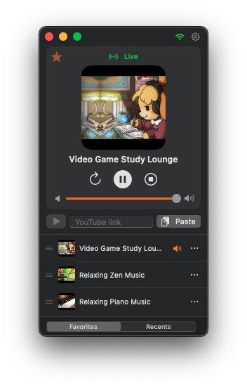

# Airwave

**A lightweight, native macOS audio stream and YouTube audio player built with SwiftUI.**


Airwave lets you listen to live internet radio, direct audio streams, and YouTube videos or live broadcasts without keeping a heavy web browser tab open. Designed exclusively for macOS Sonoma and later, it integrates seamlessly with system media controls, the Control Center Now Playing widget, and keyboard shortcuts.



---

## Features

- **Hybrid Stream Playback:** Play direct audio stream URLs (`mp3`, `aac`, `m4a`, `m3u8`, etc.) and extract audio-only or HLS live streams from YouTube links automatically.
- **Favorites Management:** Save your favorite stations and streams, rename them inline, remove them from the row's `…` menu, and reorder them by dragging (both in the main window and in Settings). Import and export your list as a lossless JSON file from Preferences.
- **Recent History:** A Recents view — switched with Favorites from the bar at the bottom of the main window — remembers your recently played tracks for quick replay. The history size (1–20, default 5) and a "Clear history" action live in **Settings → Recents**.
- **Volume Control:** In-app volume slider from 0% to 100% (default 75%), with snap stops every 25%.
- **ICY "Now Playing" Metadata:** For direct radio streams (Icecast/Shoutcast), Airwave reads inline ICY metadata to show the station name and the current song — in the player card and in macOS Control Center.
- **Smart Artwork & Metadata Caching:** Automatically fetches and downscales thumbnails from YouTube metadata, OpenGraph (`og:image`), Twitter cards (`twitter:image`), or domain favicons. Covers are refreshed on every play and persisted alongside your saved favorites and recent tracks.
- **Native macOS Integration:**
  - Full support for `MPNowPlayingInfoCenter` (Control Center & Lock Screen artwork and playback state) and `MPRemoteCommandCenter` (hardware media keys).
  - Live network status indicator (`Connected`, `Weak connection`, `No network`) with an immediate, color-coded hover label, plus a quick Preferences button embedded directly in the window titlebar.
  - A right-click Dock menu with **Play/Pause** and a **Recent Tracks** submenu for quick playback.
  - Optional **Launch at Login** via `SMAppService`.
- **Hotstart:** Optionally resume your last played stream automatically as soon as the app launches.
- **Background Playback Mode:** Choose whether closing the main window quits the application or keeps Airwave running silently in the background.

---

## Supported Streams & Limitations

Airwave is intentionally lightweight and relies on native `AVFoundation` playback combined with local YouTube stream extraction (`YouTubeKit`). Because it does **not** embed a headless web browser or bundle `yt-dlp`, please keep the following limitations in mind:

### What Works
- **Direct Audio & Playlist Streams:** Any `http://` or `https://` URL ending in `.mp3`, `.aac`, `.m4a`, `.m3u8`, `.ogg`, `.opus`, `.wav`, `.flac`, or `.pls`.
- **YouTube Videos & Live Streams:** Standard links (`youtube.com/watch?v=...`), short links (`youtu.be/...`), shorts (`youtube.com/shorts/...`), live links (`youtube.com/live/...`), and mobile links (`m.youtube.com`, `music.youtube.com`).

### Limitations (What Does Not Work)
- **Not a Universal Website Extractor:** Airwave cannot extract audio from arbitrary websites, radio station web portals, SoundCloud, Twitch, Mixcloud, or Spotify web pages. If you want to listen to an internet radio station (other than YouTube), you must provide its **direct stream URL** (e.g., an Icecast/Shoutcast `.mp3`/`.aac` mountpoint or `.m3u8` HLS manifest), not the URL of the station's homepage.
- **DRM, Age-Restricted, or Private YouTube Content:** Videos requiring authentication, cookies, age verification, or Widevine DRM cannot be resolved by `YouTubeKit`.
- **YouTube API Changes:** Because YouTube frequently updates its internal player formats, stream extraction may occasionally require updating the `YouTubeKit` dependency.

---

## Installation & Bypassing macOS Gatekeeper (Pre-built Releases)

Pre-compiled versions of `Airwave.app` are signed using an **ad-hoc local signature** (`codesign --sign -`) rather than a paid Apple Developer ID certificate. As a result, macOS Gatekeeper will quarantine the app after downloading it from a browser and show an *"Airwave.app cannot be opened because the developer cannot be verified"* or *"is damaged"* warning.

### How to Open a Pre-built Release

1. Download and extract `Airwave.app`, then move it to your `/Applications` folder.
2. **Method 1 — Terminal (Recommended & Fastest):**
   Open **Terminal** and remove the macOS quarantine extended attribute by running:
   ```bash
   xattr -cr /Applications/Airwave.app
   ```
   *(If you still need to refresh the local ad-hoc signature on your machine, you can also run `codesign --force --deep --sign - /Applications/Airwave.app`.)*
3. **Method 2 — Finder & System Settings:**
   - Control-click (or right-click) `Airwave.app` in Finder and choose **Open**.
   - On newer macOS versions, if blocked, open **System Settings → Privacy & Security**, scroll down to the **Security** section, and click **Open Anyway** next to the Airwave message.

---

## Building from Source

### Requirements
- **macOS 14.0 (Sonoma)** or later
- **Xcode 15.0+** or **Swift 5.9+** Command Line Tools

### Repository Layout Note
Make sure the Swift source files are placed inside `Sources/Airwave/` as expected by `Package.swift`:

```text
Airwave/
├── Package.swift
├── make-app.sh
├── LICENSE
├── Resources/
│   ├── AppIcon.icns
│   └── screenshot.png
└── Sources/
    └── Airwave/
        ├── AirwaveApp.swift
        ├── Components/
        ├── Services/
        └── Views/
```

### Build & Package `Airwave.app`

The repository includes a turnkey build script (`make-app.sh`) that compiles a release binary via Swift Package Manager, generates the macOS `.app` bundle structure (`dist/Airwave.app`), writes the `Info.plist` (including `NSAllowsArbitraryLoads` so non-HTTPS radio streams can play), copies `Resources/AppIcon.icns` if present, and applies an ad-hoc code signature.

```bash
# 1. Clone the repository
git clone https://github.com/Sisyffe/Airwave.git
cd Airwave

# 2. Run the packaging script
chmod +x make-app.sh
./make-app.sh

# 3. Launch the built application
open dist/Airwave.app
```

If you only want to compile or run the executable directly via SwiftPM during development:

```bash
swift build -c release
```

---

## Architecture & Code Design

Airwave is written in modern Swift with strict separation of concerns across three main layers:

```text
Sources/Airwave/
├── AirwaveApp.swift               # App entry point, WindowGroup, Playback menu commands & AppDelegate
├── Services/
│   ├── AudioPlayer.swift          # @MainActor AVPlayer wrapper, generation-safe async loading & MediaPlayer integration
│   ├── StreamResolver.swift       # Direct stream vs. YouTubeKit extraction & OpenGraph/favicon artwork fetching
│   ├── ICYMetadata.swift          # Icecast/Shoutcast inline metadata reader (station name & current song)
│   ├── Favorite.swift             # Codable Favorite model & UserDefaults-backed FavoritesStore
│   ├── FavoritesIO.swift          # Lossless JSON import/export & merge for favorites
│   ├── Recents.swift              # UserDefaults-backed RecentsStore (configurable 1–20 history)
│   └── Prefs.swift                # Centralized UserDefaults keys
├── Views/
│   ├── ContentView.swift          # Main window layout (NowPlayingCard, URL bar, list with bottom Favorites/Recents switcher)
│   └── PreferencesView.swift      # Settings window (General, Recents & master–detail Favorites tabs)
└── Components/
    ├── NowPlayingCard.swift       # Playback header with status pill, title/song, transport & volume slider
    ├── FavoritesList.swift        # Interactive list with inline rename & native drag-to-reorder
    ├── RecentsList.swift          # Recently played tracks with quick replay
    ├── TitlebarAccessory.swift    # AppKit NSTitlebarAccessoryViewController + NWPathMonitor network indicator
    ├── AddFavoriteSheet.swift     # Modal sheet for naming a newly saved favorite stream
    └── Thumb.swift                # Reusable rounded thumbnail view with fallback icon
```

### Key Design Highlights
- **Concurrency & Generation-Safe Playback (`AudioPlayer`):** Annotated with `@MainActor` and conforming to `ObservableObject`, `AudioPlayer` uses an internal `generation` counter (`UInt64`). If a user rapidly switches streams while one is still resolving, stale asynchronous tasks automatically abort without corrupting the active player state. If a stream fails to resolve, the player gracefully restores the previous stream and state.
- **Stream Resolution Pipeline (`StreamResolver`):**
  1. Validates `http`/`https` schemes and checks whether the URL extension matches known direct audio formats.
  2. For YouTube URLs, queries `YouTubeKit` locally and selects the best stream in priority order: **HLS live stream** → **highest-bitrate M4A audio-only stream** → **lowest-resolution natively playable muxed stream**.
  3. Fetches artwork asynchronously (up to 300 KB of HTML inspected for `og:image` / `twitter:image` meta tags, falling back to Google's S2 favicon service) and downscales images to 256 px PNG data for compact storage.
- **ICY Metadata Reader (`ICYMetadata`):** For direct radio streams, a second, audio-less connection parses inline `icy-metaint` blocks to surface the station name and current song without touching the playback pipeline; the task is generation-guarded and cancelled on stop or track change.
- **Lightweight Persistence (`FavoritesStore`, `RecentsStore` & `Prefs`):** Favorites, recent history, and cached thumbnail `Data` are serialized as JSON in `UserDefaults`, keeping the app completely self-contained with zero external database dependencies.

---

## Keyboard Shortcuts

| Action | Shortcut |
| :--- | :--- |
| **Play / Pause** | `Space` (via Playback menu) or Media Play/Pause key |
| **Stop Stream** | `⌘.` (`Cmd + Period`) |
| **Refresh Stream** | `⌘R` (`Cmd + R`) |
| **Volume Control** | In-app volume slider, 0–100% with 25% snap stops (persisted across launches) |

---

## License

Released under the **MIT License**. Copyright © 2026 Sisyffe. See [`LICENSE`](LICENSE) for full details.